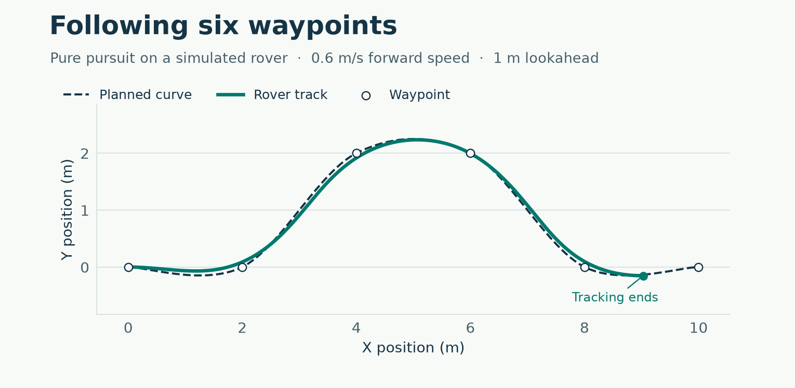

# algo-motion

Turn waypoints into a smooth path and steer a simulated rover along it in portable C99.

**Contents** · [Choose a library](#choose-a-library) · [Try the example](#try-the-example) · [Add it to your project](#add-it-to-your-project)

## Choose a library

| Library | What it does | Example and API |
| --- | --- | --- |
| [path-pursuit](path-pursuit/) | Build a smooth path and track it using pure pursuit. | [follow](path-pursuit/examples/follow.c) · [API](path-pursuit/include/path.h) |
| [trajectory-profile](trajectory-profile/) | Planned trapezoidal and S-curve speed profiles. | Planned |

## Try the example

From this repository’s root, use Make and a C99 compiler. No robot hardware is needed.

```sh
make -C path-pursuit run
```



Follow a rover through an S-bend. The example prints its position and distance from the path until the final waypoint is within its lookahead distance. [Example source](path-pursuit/examples/follow.c)

## Add it to your project

For plain C, compile the source files in the library’s `src/` directory and add its `include/` directory to your compiler’s include path. For a CMake application named `app`, place this checkout inside your project and use the following lines.

```cmake
add_subdirectory(algo-motion/path-pursuit)
target_link_libraries(app PRIVATE algo::path-pursuit)
```

For ESP-IDF, add the library directory to `EXTRA_COMPONENT_DIRS` and its name to the consuming component’s `REQUIRES`. Select either the individual libraries or the entire repository to avoid duplicate symbols.

<details>
<summary>Fetch just this library from GitHub with CMake</summary>

```cmake
include(FetchContent)
FetchContent_Declare(algo_path_pursuit
    GIT_REPOSITORY https://github.com/JonasAtelier/algo-motion.git
    GIT_TAG        stable
    SOURCE_SUBDIR  path-pursuit)
FetchContent_MakeAvailable(algo_path_pursuit)
target_link_libraries(app PRIVATE algo::path-pursuit)
```

</details>

Run `make check` from the repository root to test the libraries. [MIT license](LICENSE)

[Browse the workshop catalog · Portable C libraries](https://github.com/JonasAtelier/jonas-atelier-libraries#portable-c-libraries)
